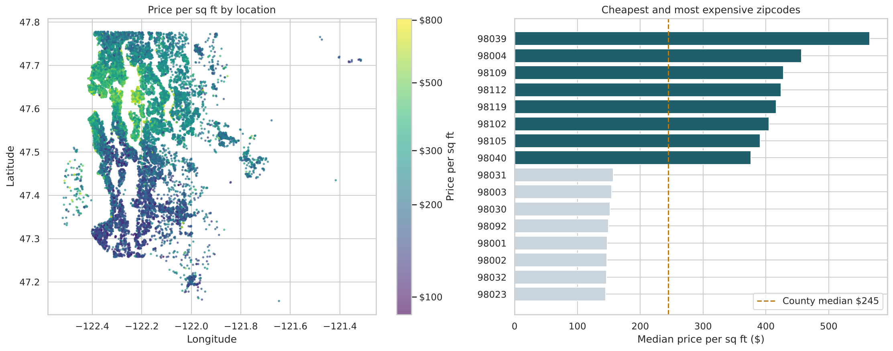
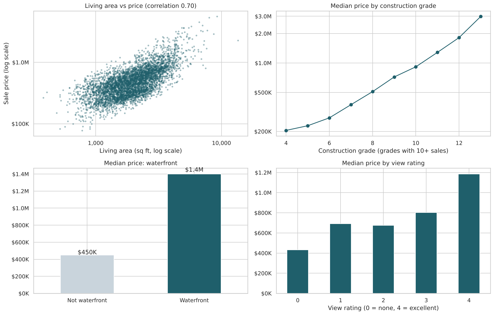

# House Price Analysis: King County, Washington

**What drives house prices, and how accurately can we estimate them? Location, size and build quality explain most of the price, and a gradient-boosted model estimates prices with a typical error of about 8%.**

Based on 21,613 house sales in King County (including Seattle), May 2014 – May 2015.



## Business question
A buyer, seller or lender wants a fair estimate of a home's value. Which characteristics matter most, and how close can a model get to the actual sale price?

## Data
- **Source:** King County House Sales dataset (Kaggle)
- **Size:** 21,613 sales × 21 columns
- **Key fields:** price, living and lot area, bedrooms, bathrooms, floors, waterfront, view, condition, construction grade, year built and renovated, zipcode, latitude and longitude

## Approach
1. **Data quality:** corrected a 33-bedroom house in 1,620 sq ft (a typing error for 3), kept 177 genuine resales, and turned `yr_renovated = 0` ("never renovated") into a yes/no flag instead of treating it as the year 0.
2. **Analysis:** price distribution, price per sq ft by zipcode and on a map, and the effects of size, grade, waterfront and view, using medians because prices are heavily skewed.
3. **Trend check:** the data covers only 13 months, so I compared monthly medians instead of "2014 vs 2015".
4. **Modelling:** split the data first, then compared five approaches on unseen sales: a median-price baseline, my original linear model, Ridge regression with log price and log sizes and zipcode as a category, Random Forest, and Gradient Boosting. Results confirmed with 5-fold cross-validation and permutation importance.

## Key findings
- **Location sets the price per square foot**, which ranges 3.9× across zipcodes ($145 to $565).
- **Construction grade matters a lot:** each step up adds roughly 30–40% to the median price.
- **Waterfront homes sell for about 3× the median** ($1.4M vs $450K).
- **Prices were flat over the 13 months** ($425K–$477K monthly median). The "2014 vs 2015" comparison in my first version compared 8 months with 5.



| Model (test set, 4,323 sales) | Typical % error | MAE | R² |
| --- | --- | --- | --- |
| Baseline: median price | 34.3% | $229,736 | –0.07 |
| Linear Regression (my first version) | 19.4% | $127,455 | 0.70 |
| Ridge (log price and size, zipcode as category) | 9.8% | $75,730 | 0.87 |
| Random Forest | 8.9% | $72,265 | 0.87 |
| **Gradient Boosting** | **8.2%** | **$65,017** | **0.90** |

5-fold cross-validated R² for Gradient Boosting: 0.89 ± 0.02.

## What I learned
My first version reported R² as "accuracy" and treated zipcode as a number. Representing the data correctly (zipcode as a category, prices and sizes on a log scale) took the simple linear model from R² 0.70 to 0.87. That was a bigger improvement than switching to a more complex algorithm.

## Recommendations
- **To price a home:** start from the zipcode's price per square foot, then adjust for grade, waterfront and view.
- **For an automated valuation tool:** the model is accurate enough for a first estimate on typical homes; high-end homes, where errors are larger, should go to an appraiser.
- **To improve the model:** add school ratings, distance to downtown and transit, and recent nearby sales.

## Limitations
- One county and 13 months; the model should not be applied to other areas or later years without retraining.
- 177 homes were sold twice, so a few may appear in both the training and test sets.

## Files
| File | What it is |
| --- | --- |
| `house_price_analysis.ipynb` | Full analysis (runs top to bottom) |
| `house_price.csv` | Dataset |
| `powerbi_sales.csv`, `powerbi_zipcodes.csv` | Clean tables for a Power BI dashboard |
| `images/` | Charts used in this README |
| `requirements.txt` | Python packages |

## How to run
```
pip install -r requirements.txt
jupyter notebook house_price_analysis.ipynb
```

**Tools:** Python, Pandas, NumPy, Matplotlib, Seaborn, Scikit-learn
